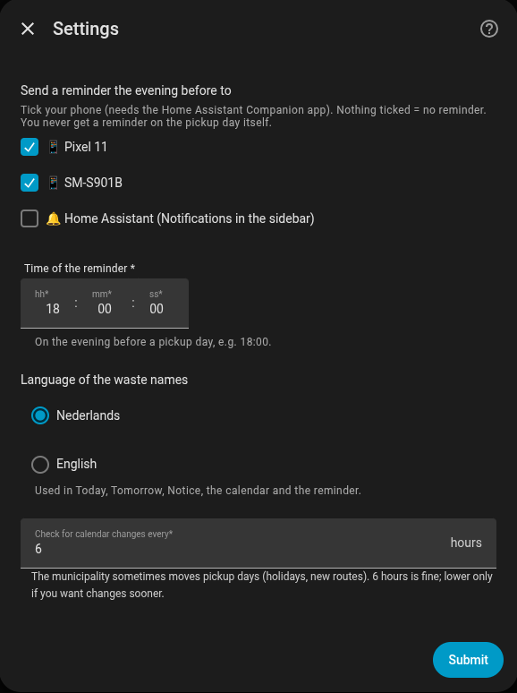

# Afvalwijzer Utrecht for Home Assistant (unofficial)

> Community project. Not made, endorsed or supported by Gemeente Utrecht.
> Uses the same data as the official *Afvalwijzer Utrecht* app.

[](https://my.home-assistant.io/redirect/hacs_repository/?owner=martijnvwezel&repository=afvalwijzer-utrecht-ha&category=integration)

See **when your bin is collected** in Home Assistant, for every address in the
municipality of **Utrecht** (also Leidsche Rijn, Vleuten and De Meern).
You only need your **postcode and house number**. No account.

You get:

- a **calendar** with all pickup days (shows up in the HA calendar, and works with automations)
- **Today** and **Tomorrow**: e.g. `Papier` or `Geen`
- **Notice**: one line for your dashboard, e.g. `Vandaag: Papier · Morgen: Groente, fruit en tuin`
- **Pickup today or tomorrow**: on/off, to show a card only when it matters
- **Next pickup** (date) and **Next waste type** (text)
- one date sensor per waste type (GFT, Papier, ...) with the official instructions


## Install

1. Install [HACS](https://hacs.xyz) if you don't have it.
2. Click **Open in HACS** above (or HACS → ⋮ → *Custom repositories* →
   `https://github.com/martijnvwezel/afvalwijzer-utrecht-ha`, type *Integration*), then *Download*.
3. Restart Home Assistant.
4. Settings → Devices & services → **Add integration** → *Afvalwijzer Utrecht*.
5. Type your postcode and house number (and addition like `A` if you have one). Done.

No HACS? Copy `custom_components/afvalwijzer_utrecht` into `/config/custom_components/` and restart.

## Show a card only when the bin goes out

```yaml
type: conditional
conditions:
  - condition: state
    entity: binary_sensor.afval_ophalen_vandaag_of_morgen
    state: "on"
card:
  type: tile
  entity: sensor.afval_melding
  icon: mdi:delete-alert
```

(Entity ids depend on your Home Assistant language. With Home Assistant in English they are
`binary_sensor.waste_pickup_today_or_tomorrow` and `sensor.waste_notice`.)

## Settings: reminder on your phone

Get a push message **the evening before** a pickup day, e.g.
*"Morgen: Papier. Zet de container vanavond buiten."* Never on the pickup day itself.

1. Settings → Devices & services → **Afvalwijzer Utrecht**.
2. Click the **gear** (⚙) next to your address.
3. Under **Send a reminder the evening before to**, tick your phone.
   (Your phone shows up here once the Home Assistant Companion app is installed and logged in.)
4. Set **Time of the reminder** (default 18:00).
5. **Submit**. Done.



The same dialog has two more settings:

- **Language of the waste names**: Dutch (default, e.g. `Papier`, `Vandaag: ...`) or English.
  Used in Today, Tomorrow, Notice, the calendar and the reminder.
- **Check for calendar changes every ... hours** (default 6): the municipality sometimes
  moves pickup days (holidays, new routes); this is how often Home Assistant checks.
  "Today" and "Tomorrow" always switch at midnight, whatever you pick here.

## Nederlands, kort

Installeer via HACS, herstart, en kies *Instellingen → Apparaten & diensten →
Integratie toevoegen → Afvalwijzer Utrecht*. Vul postcode en huisnummer in. Je krijgt een
agenda met ophaaldagen, sensoren *Vandaag*, *Morgen* en *Melding*
(`Vandaag: Papier · Morgen: Groente, fruit en tuin`), en een aan/uit-sensor
*Ophalen vandaag of morgen* om een kaart alleen te tonen als het nodig is.

**Herinnering op je telefoon** (de avond van tevoren, nooit op de ophaaldag zelf):
*Instellingen → Apparaten & diensten → Afvalwijzer Utrecht → tandwiel (⚙) bij je adres* →
vink je telefoon aan bij *Herinnering de avond van tevoren sturen naar*, kies de tijd
(standaard 18:00) → *Verzenden*. Je telefoon moet de Home Assistant-app hebben.
